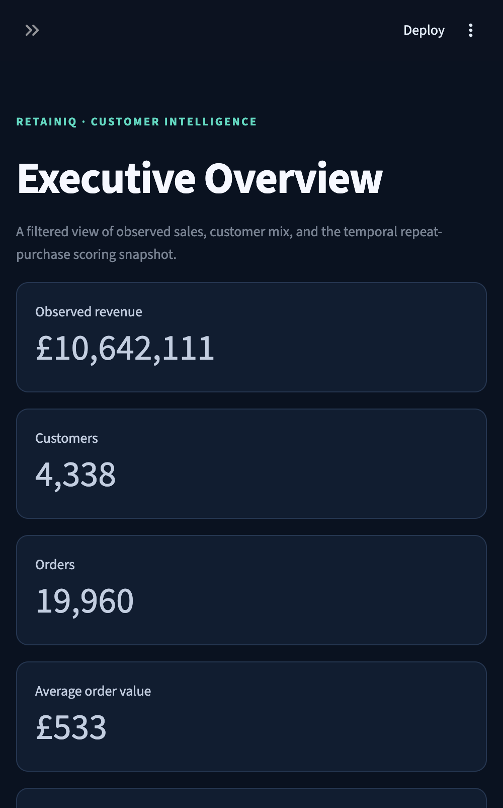
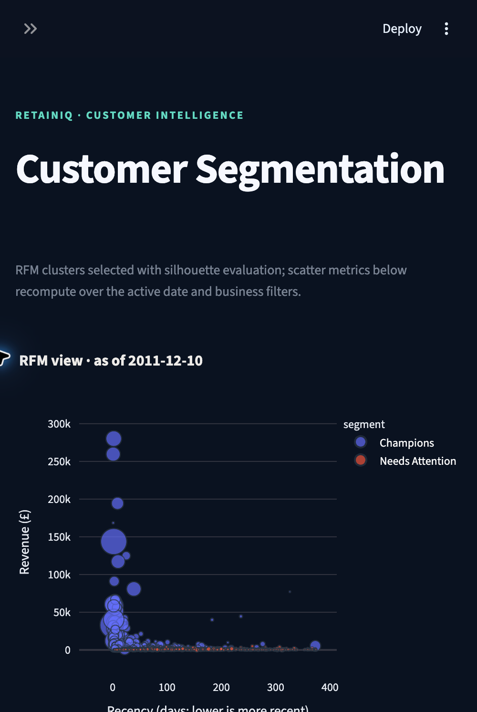
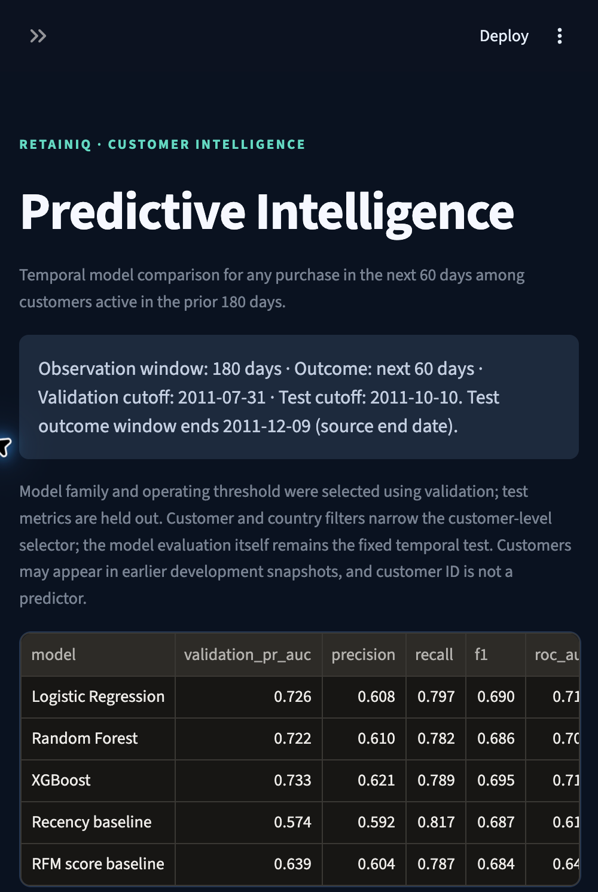

# RetainIQ — customer intelligence and revenue analysis

RetainIQ addresses a practical e-commerce problem: transaction data is abundant, but operators need a defensible way to understand customer value, repeat-purchase behavior, and product demand before deciding where to investigate. This project builds an auditable analytics pipeline and interactive decision-support dashboard around those questions.

**Problem and product:** convert raw invoice lines into trustworthy customer, cohort, and product evidence, then surface it through an executive Streamlit dashboard.

**Data and stack:** 541,909 UCI Online Retail records; Python, pandas, scikit-learn, XGBoost, SHAP, mlxtend, Streamlit, and Plotly.

**Methods:** RFM features and K-Means segmentation; Apriori market-basket rules; temporal repeat-purchase prediction with Logistic Regression, Random Forest, and XGBoost; SHAP explanations and bootstrap evaluation.

**Result and caveat:** the validation-selected XGBoost model reached test PR-AUC **0.762**, above the RFM-score baseline **0.677** and nearly tied with Logistic Regression (**0.762**). Historical observational data predicts repeat buying; it cannot establish whether a retention offer causes a purchase.

## Screenshots

| Executive overview | Customer segments | Predictive intelligence |
|---|---|---|
|  |  |  |

## Decision questions

- Where do revenue, order frequency, country, and product patterns concentrate?
- How do customers differ in recency, frequency, and monetary value?
- Which active customers have higher observed purchase probability over the next 60 days?
- How does month-one retention vary across acquisition cohorts?
- Which products appear together in invoice baskets?
- Which customer groups and customers may warrant human review?

## Data and attribution

Chen, D. (2015). *Online Retail* [Dataset]. UCI Machine Learning Repository. [Dataset page](https://archive.ics.uci.edu/dataset/352/online-retail), [DOI 10.24432/C5BW33](https://doi.org/10.24432/C5BW33). Dataset license: [CC BY 4.0](https://creativecommons.org/licenses/by/4.0/). The source workbook contains **541,909 invoice-line rows** from 1 December 2010 through 9 December 2011. Raw files are downloaded to `data/raw/` and excluded from Git.

The RetainIQ source code is provided under the [MIT License](LICENSE). This software license does not replace the dataset's attribution and license requirements.

## What the pipeline does

### Ingestion and cleaning

`src/retainiq/data/download.py` retrieves the original UCI data; `profile.py` records the workbook schema, quality profile, and SHA-256. `preprocessing.py` applies mutually exclusive, first-match row decisions so the audit reconciles to the source. It retains the first exact duplicate, separates cancellation invoice lines, segregates other negative-quantity returns without inventing original-invoice matches, and excludes invalid or zero-price lines from positive-sales revenue.

The verified run retained **524,878 positive sale lines**, including **132,186 anonymous lines** for aggregate analysis; it created **19,960 invoice records** and **4,338 identified customers**. The remaining **17,031 rows** were audited as duplicates, cancellations, returns, invalid prices, or zero-price lines. Positive-sales revenue was **£10.64m**. It is gross positive sales in nominal GBP, before return reconciliation, and is not net revenue or profit.

### Exploratory and customer analysis

- **EDA:** monthly revenue, orders, customers, average order value, repeat-purchase rate, product and country contribution, and customer revenue concentration.
- **RFM:** recency, unique invoice frequency, and positive-sales monetary value are calculated as of 10 December 2011. RFM quantile scores are provided alongside K-Means clusters.
- **K-Means:** log1p-transformed RFM values are standardized; silhouette, Davies–Bouldin, and inertia are compared for k=2…8. The selected k=2 solution has silhouette **0.433**. A fixed-seed 100-resample bootstrap compares each k=2…6 partition to the full-sample partition using Adjusted Rand Index (ARI).
- **Secondary segmentation:** the dashboard and `secondary_k4_profiles.csv` show an exploratory k=4 profile. It gives more detail, but its mean bootstrap ARI (**0.884**) is below k=2 (**0.980**) and the silhouette is lower (**0.334** vs. **0.433**). Keep k=2 as the simpler primary view unless the extra k=4 distinctions support a specific operating decision.

Selected primary profiles from the verified run:

| Profile | Customers | Median recency | Mean orders | Mean historical revenue |
|---|---:|---:|---:|---:|
| Champions | 1,668 | 17 days | 8.44 | £4,535.74 |
| Needs Attention | 2,670 | 96 days | 1.67 | £494.98 |

These names summarize relative historical behavior. They are not externally validated personas or treatment groups.

### Repeat-purchase prediction

The prediction unit is an identified customer active at least once during a **180-day observation window**. The target is any positive-sale invoice during the following **60 days**. Features use only the observation window: order count, revenue, units, average order value, recency, distinct active days, product diversity, and recent-versus-prior revenue. Customer ID is never a model feature.

The primary temporal evaluation trains on the 31 May 2011 snapshot, selects model/threshold on 31 July, and tests on 10 October; the test outcome window ends at the source boundary on 9 December. Logistic Regression, Random Forest, and XGBoost are compared with two transparent ranking baselines: lower recency first and a composite RFM score. Baselines are rankings, not calibrated probabilities. Their F1 thresholds are selected on validation just like the learned model thresholds.

The intervals below are percentile **95% stratified bootstrap confidence intervals with 1,000 resamples**. F1 uses the threshold selected on validation and held fixed in the test resamples. These intervals describe sampling variability at this one test cutoff; they do not capture season-to-season or retailer-to-retailer uncertainty.

| Test ranking method | ROC-AUC (95% CI) | PR-AUC (95% CI) | F1 (95% CI) |
|---|---|---|---|
| Logistic Regression | 0.715 (0.697–0.731) | 0.762 (0.746–0.778) | 0.690 (0.677–0.703) |
| Random Forest | 0.700 (0.681–0.719) | 0.754 (0.736–0.771) | 0.686 (0.671–0.699) |
| XGBoost | 0.716 (0.698–0.734) | 0.762 (0.744–0.778) | 0.695 (0.681–0.708) |
| Recency baseline | 0.613 (0.592–0.633) | 0.604 (0.584–0.625) | 0.687 (0.674–0.699) |
| RFM-score baseline | 0.640 (0.620–0.660) | 0.677 (0.657–0.696) | 0.684 (0.669–0.696) |

XGBoost was selected by validation PR-AUC (**0.733**). Its final test PR-AUC is nearly identical to Logistic Regression, and the intervals overlap substantially. The results do not establish a robust winner. Test prevalence was **53.14%** across **3,007 customer snapshots**.

#### Calibration and reliability

The selected model's Platt sigmoid calibrator is fitted on validation predictions and labels only; the choice to use it is also made on validation, never on the test set. Validation Brier score changed from **0.2013** uncalibrated to **0.1990** calibrated, so this run uses calibrated probabilities in the revenue-exposure proxy. On the held-out test, Brier changed from **0.2134** to **0.2175**: the validation improvement did not transfer to this test period. The reliability chart and both Brier scores are saved in the prediction artifacts. This is a single test-period diagnostic, not a guarantee that calibration will help or hurt in deployment.

#### Rolling-origin evaluation

Three earlier cutoffs (31 July, 31 August, and 30 September 2011) are scored independently. A historical training snapshot is eligible only if its full 60-day outcome window ends on or before that origin's evaluation date. The table reports mean and sample standard deviation of PR-AUC over these three origins:

| Method | Mean PR-AUC ± origin SD | 31 Jul PR-AUC (44.35% positive) | 31 Aug PR-AUC (49.06% positive) | 30 Sep PR-AUC (52.55% positive) |
|---|---:|---:|---:|---:|
| Logistic Regression | 0.745 ± 0.018 | 0.726 | 0.748 | 0.762 |
| Random Forest | 0.742 ± 0.013 | 0.728 | 0.750 | 0.750 |
| XGBoost | 0.752 ± 0.014 | 0.736 | 0.757 | 0.762 |
| Recency baseline | 0.595 ± 0.019 | 0.574 | 0.602 | 0.610 |
| RFM-score baseline | 0.661 ± 0.019 | 0.639 | 0.668 | 0.675 |

Values in parentheses are positive-label prevalence for that evaluation origin: **44.35%** on 31 July (1,229 / 2,771 snapshots), **49.06%** on 31 August (1,360 / 2,772), and **52.55%** on 30 September (1,537 / 2,925). The changing prevalence matters because PR-AUC depends on the positive-class rate. Three origins provide a useful temporal check but remain a small sample of historical scoring dates; the standard deviation is not a confidence interval.

### Cohort retention and product associations

Monthly cohorts use the month of first observed positive invoice. Retention at age N is active identified customers in month N divided by cohort-month customers. December 2010 is marked **left-censored** because customers may have purchased before the dataset begins; it is excluded from the headline median month-one retention. The verified median month-one retention across the 11 other cohorts with observable month one is **19.0%**. Later cohorts are right-censored where the source does not yet provide follow-up.

Market basket analysis uses Apriori on invoices containing one of the 75 most frequent products; support, confidence, and lift are reported. Dashboard associations recompute within the selected filters and a smaller 35-product candidate set. Rules describe co-purchase, not a causal bundle effect.

## Streamlit dashboard

Run the seven pages locally:

1. **Executive Overview** — filtered commercial KPIs, revenue patterns, and concentration.
2. **Customer Segmentation** — RFM profiles, primary k=2 and secondary k=4 views, stability diagnostics, and customer export.
3. **Predictive Intelligence** — model/baseline comparison, temporal curves, bootstrap intervals, calibration/reliability, and SHAP explanations.
4. **Cohort Retention** — retention heatmap/curves, cohort revenue, left-censor caveat, and lifecycle measures.
5. **Product Intelligence** — product performance and filtered Apriori rules.
6. **Business Recommendations** — evidence-linked actions and limitations.
7. **Data Explorer** — prepared tables and cleaning audit.

Date, country, customer, segment, product, and revenue filters are available where applicable. Predictive test metrics describe fixed historical cutoffs and do not change with dashboard filters.

## Architecture and outputs

```text
app.py                                   Streamlit presentation and filters
src/retainiq/data/download.py            UCI data download
src/retainiq/data/profile.py              source schema, checksum, quality profile
src/retainiq/preprocessing.py             cleaned transaction/customer tables and audit
src/retainiq/analytics/eda.py              EDA metrics
src/retainiq/segmentation.py               RFM, K-Means, stability, profiles
src/retainiq/prediction.py                 temporal models, baselines, calibration, CIs
src/retainiq/retention.py                  cohort and lifecycle analysis
src/retainiq/market_basket.py              Apriori analysis
src/retainiq/recommendations.py            evidence-linked decision support
src/retainiq/run_pipeline.py               orchestration and visual outputs
data/processed/                            generated tables and fitted models (ignored)
reports/                                   generated run summary and Plotly visuals (ignored)
docs/technical_report.md                  assumptions, methods, and detailed findings
tests/                                     unit tests and analytical invariants
```

Important generated artifacts include `reports/run_summary.json`, `data/processed/prediction/model_metrics.json`, `reliability_curve.csv`, `rolling_origin_metrics.json`, `cluster_stability.json`, `secondary_k4_profiles.csv`, and `cohort_metadata.csv`. The complete generated data and model binaries are ignored by Git and rebuilt by the pipeline.

## Reproduce locally

Verified with Python 3.13. Create and activate an environment, then install the exact direct dependency pins:

```bash
python3 -m venv .venv
source .venv/bin/activate
python scripts/check_requirements_pins.py
pip install -r requirements.txt
```

Download the source (or place the official archive in `data/raw/`), profile, clean, analyze, train, and generate artifacts:

```bash
PYTHONPATH=src python -m retainiq.data.download
PYTHONPATH=src python -m retainiq.run_pipeline --source data/raw/online_retail.zip --project-root .
```

Launch the dashboard:

```bash
PYTHONPATH=src streamlit run app.py --server.port 8501
```

Open `http://localhost:8501`. Run the checks:

```bash
python scripts/check_requirements_pins.py
PYTHONPATH=src python -m unittest discover -s tests -v
```

GitHub Actions runs the exact-pin check and unit suite on pushes and pull requests.

## Limitations and responsible interpretation

- The source is one retailer's roughly one-year history, ends in December 2011, and contains no margin, marketing-contact, treatment, inventory, or channel outcomes.
- Positive-sales revenue is gross of returns; it is nominal GBP and is neither profit nor net sales.
- The earliest December 2010 cohort is left-censored. It remains visible and marked in cohort outputs, but is excluded from headline month-one retention; the short follow-up also right-censors recent cohorts.
- One end-of-history test and three rolling origins cannot establish broad temporal or external validity. Bootstrap intervals reflect within-test sampling uncertainty only.
- Calibration was selected using validation Brier only. Its validation improvement did not carry through to the test set, where calibrated Brier was higher; therefore calibrated exposure rankings may be miscalibrated in a future period.
- The revenue exposure proxy is trailing 180-day revenue times probability of no purchase in the next 60 days; it is not a revenue-loss forecast or an intervention effect.
- SHAP describes model attribution, not causal effect. K-Means names are post-hoc profiles. Apriori lift is co-occurrence. None establishes that an action will increase retention or revenue.
- The repeated customer snapshots and single-company setting can make performance different from a genuinely new-customer or new-retailer deployment. Validate prospectively before operational use.

See [the technical report](docs/technical_report.md) for the complete methods, split dates, cleaning policy, and further verified findings.
